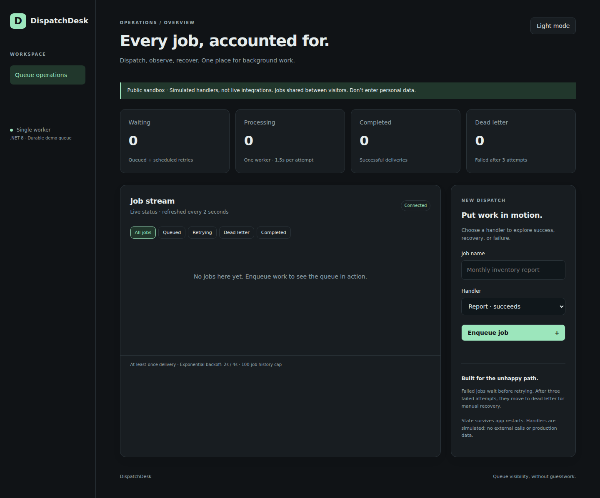

# DispatchDesk
.NET 8 durable job-queue sandbox with responsive native HTML/CSS/JS dashboard.

## Run
`dotnet run --project api` (requires .NET 8). Set `DISPATCH_DATA` to an absolute JSON file path for persistence; default local application-data folder. `python3 verify.py` runs isolated lifecycle integration tests after `dotnet build api` (script currently uses VPS SDK path).

Handlers: report succeeds, unstable succeeds on second attempt, broken dead-letters after three. Single worker, 1.5-second simulated processing, retries at 2/4 seconds. Dead letters can be requeued. Jobs persist via atomic file replacement; processing jobs requeue at startup (at-least-once semantics).

## Deliberate limits
Single-process store; no multi-worker leases, broker, real integrations, authentication, audit log, or exactly-once promises. At most 20 active jobs and 100 retained jobs; oldest completed job evicted when full. Dead letters are retained. Do not use for production, secrets, or personal data. Public sandbox shares state among visitors. File replacement protects against partial writes, not guaranteed power-loss durability. For real deployments use transactional DB/broker, authenticated access, idempotent handlers and per-user rate limiting. Persistence errors stop worker rather than silently discard work.

## Preview

